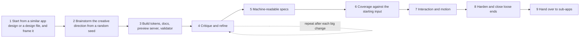

# Build a Brand Design System

Repository-local playbook. It turns "I have a few apps under one brand and want every new one to look and behave the same" into a **brand master repo**: one design system that people browse and agents read, plus a skill that hands it to each new sub-app.

It records how the MathGo design system in this repo was built, from 14 Oct to 19 Nov 2026, so another brand can follow the same route. Each phase has a goal, the steps, what it produces, a gate before moving on, and the **prompts the MathGo owner actually typed**. The prompts are quoted as typed: they were voice-dictated, so "MaxCo" and "Netplane girl" mean MathGo and NaplanGo, and "math goal" and "Mesco" mean MathGo. Swap in your own brand, apps, and audience.

## What you end up with

| Area | MathGo artifact | Purpose |
|---|---|---|
| Tech-stack baseline | `tech-stack-cadence.md`, `.skills/ask-mathgo-master/` | Shared framework choices for new apps, and a skill agents query for them |
| As-built inventory | `implemented-components.md`, `implemented-page-structures.md` | What the existing apps already use; the spec must cover it |
| Tokens and themes | `design/tokens/tokens.json` (DTCG), `themes.css`, `tailwind-theme.css`, `token-taxonomy.md` | 4 core themes (light, dark, high-contrast, junior age knob), compact density, reduced motion |
| Seeded worlds | `design/tokens/worlds/<slug>.{json,css}` | 8 bold alternative skins, each with 4 colour options |
| Foundations | `design/foundations/*.md` | Design language, typography and maths, accessibility, imagery, motion |
| Component specs | `components/component-specs.json` (97 components) and family docs | Anatomy, attributes, token bindings, and states for each component |
| Page structures | `patterns/page-structures.json` (13 archetypes, 16 variants, 18 conventions) and blueprints | What every page shares, and each page type |
| Controller logic | `components/controllers.json` (41 state machines) and `preview/controllers/*.ts` | What clicking, typing, validation, focus moves, and timers do |
| Motion | `components/motion.json` (29 patterns), `preview/mathgo-motion.css`, `useMotion.ts` | How elements enter, leave, and respond |
| Live preview | `design/app` (Next.js): `/design`, `/design/specs`, `/design/pages`, `/design/behavior`, `/design/motion`, `/worlds`, `/overview`, `/examples/*` | People see every token, component, page, and interaction |
| Agent contract | `agent-contract/screen-generation-rules.md`, `design/AGENTS.md` | The steps an agent must follow to build a screen |
| Guardrails | `validation/validate-design-system.mjs` and tests, `smoke-report.md` | Contrast, token use, raw-value bans, spec references, motion budget |
| Critique | `.omp/agents/design-reviewer.md`, `research/*-review.md` | An independent reviewer with scored reports |
| Handoff | `governance.md` → Adoption guidance, `.skills/apply-mathgo-theme/` | Copy-based adoption with a default theme; the skill takes a theme name |

## The journey

### Phase 1: Start from a similar app design or a given design file, then frame the system

**Goal:** base the system on real input instead of a blank page, and agree on scope with the owner before building. Don't skip this phase: everything later depends on the inputs and answers gathered here.

1. **Bring one starting input into the repo:**
   - **Similar apps:** design docs or exports from apps the brand already ships, or from comparable apps. MathGo used `mathgo-tech-design.md` and `naplango-tech-design.md`, and later exported their as-built components and page structures to `implemented-components.md` and `implemented-page-structures.md`, which Phase 6 checks against.
   - **A given design file:** a `DESIGN.md` (or similar brief) that sets the brand's tone, colours, type, and audiences. Treat it as the brief: the system must keep its rules, and Phase 6 checks coverage against it.
2. **Optional, when starting from apps:** turn their stacks into a short tech-stack cadence (for each purpose, the framework, platform, or library to use) and wrap it in a repo-local skill under `.skills/`, so agents building later apps get the same stack. MathGo's cadence names Next.js 16, React 19, and Tailwind 4.
3. **Frame the system** with one big ambition prompt (below). Ask for more than tokens: components, widgets, common page structures, a preview tool, and online research.
4. **Get interviewed** in a friendly way, one multiple-choice question at a time. The answers fix the audiences, the core themes, and any age or role setting (MathGo added **Junior**, which changes target sizes, answer slots, and type size as well as colours).
5. Skip the separate spec and ticket steps. Record the interview answers in the repo and go to Phase 2.

**Gate:** the starting input is in the repo, the stack is chosen, and the owner has answered the interview.

Example prompts:

> You should have 2 text back in your folder from 2 applications called MaxCo and Netplane girl. […] based on the choices of the framework, the platform and the libraries used by these 2 applications, create a tech stack decision choice documentation which can be used by next time when I want to start an application […] the file will be called tech stack cadence. […] read these 2 documents, find the similarity and then create a document compacted documents easy to understand but list out for each function or requirement or purpose what's the recommended framework, platform or libraries.

> Now I could create a skill called Ask Med Skill Master. This skill will be the entry for the other agents to want to read or ask the questions or search for recommendations based on the knowledge within this repo. […] "I want to build a user function including registration and login. Give me the recommendation." […] this skill will output the recommended platform or technologies […] for the users to confirm.

> skill is called ask-mathgo-master · the skill is stored in this repo only · the skill can be found by different agents. not bind to oh-my-pi

> /skill:wayfinder I want to build a design system for all mathgo sub-applications. This design system will be used for the refernce when agents needs to create screens. This design system will support different themes for the applications to pick up or customize. But the main goal for this design system is to make all the sub-applications I created under math goal is similar or follow the exactly same design system, including those little atomic containers or the font. I want you to be very creative here in terms of defining a design system. What I want is not just a design MD file that defines the tokens, but also more granular to the display of component or widget or the elements that are used by the page, even some of the common page structure that is used by most of the publications, like profile management, etc. So be very comprehensive for what's needed by a style guide or design system and ideally build up some easy preview tools that I can see what has been defined in this design system. Do a bit of search online as much as you can, so that you could gain more knowledge about this design guide. Store the artifacts on the folder called the design so far, and that's for the phase 1 requirement.

> grill me in a friendly way usring friendly grill skill

Starting from a design file instead, a prompt in the same spirit: *"Read @DESIGN.md. It is the brief for the <Brand> design system. Build a design system for all <Brand> sub-applications that keeps every rule in it […]"*, followed by the same interview request.

### Phase 2: Brainstorm the creative direction from a random seed

**Goal:** choose a distinctive direction before building, so the system doesn't settle into a generic look. MathGo's first build looked "very normal"; seeding the brainstorm up front avoids that round trip.

1. Have the agent generate a long random alphanumeric string with a shell script, read creative direction from it (colour, layout, type, sub-patterns, special numbers), and never show the string in the design.
2. Ask for a broad list of bold directions, not a deep one. Each idea is a candidate **world**: a complete alternative skin over the same structure, which may change palette, faces, shape, depth, texture, and one signature interaction, but never spacing, density, target sizes, or motion.
3. Pick the direction for the core themes and the worlds worth building. Prune hard. MathGo built 20 worlds, deleted 12 after review and hands-on checks, and kept 8.
4. Plan 4 colour options per world, each held to the same contrast rules as the core themes.
5. Before building a world in full, have a `world-previewer` subagent (`.omp/agents/world-previewer.md`, effort medium) build a quick standalone preview of it, one agent per world, so the owner picks from what they can see.

**Gate:** the owner has chosen the core direction and the list of worlds to build.

Example prompts:

> the design and theme are very normal. Give me something totally unique. make every theme design decision completely random

> Follow this procedure: Generate a long, random alphanumeric string using a shell script. Define the creative direction (color scheme, layout, typography, etc.) based on the string. Look beyond the surface for subpatterns, special numbers, anything that inspires you. Use your judgment to bring this direction to life and make it look great. Don't reveal the string in the design. It's only for your inspiration. Give me something totally unique. Make every design decision completely at random. for the design and theme of mathgo.

> give me a list of ideas of theme, don't go deep, go broad. I want bold and unique design. → implement this ideas.

> delete world rubber stamp office, split-flap station, diagonal poster, cube 27, nine inks, marbled endpapers. topo terrain, graph-paper brutalist. if there are subagent related to these worlds, abort them as well.

### Phase 3: Build tokens, docs, preview server, and validator

**Goal:** a system you can run, see, and check, built from the Phase 1 answers and the Phase 2 direction.

1. **Research first.** Save sources as notes the docs cite: mature systems (Spectrum, Atlassian, Carbon, GOV.UK, Open UI, WAI-ARIA APG), DTCG tokens, WCAG 2.2, Tailwind v4 theming, and the choice of preview tool (MathGo used a custom Next.js route instead of Storybook).
2. **Tokens:** typed DTCG JSON in primitive → semantic → component tiers. Generate CSS variables (`--<brand>-*`) for each core theme. Add a Tailwind 4 bridge that exposes only semantic utilities.
3. **Worlds:** one JSON definition and one scoped stylesheet per chosen world, with its colour options.
4. **Foundations and components:** design language, type scale, accessibility, containers, primitives, and domain widgets (MathGo: answer slots, number pad, equation rows, manipulatives).
5. **Blueprints:** learner, adult/admin, and system-state pages.
6. **Agent contract:** a numbered flow agents follow to build a screen, the tokens allowed, the patterns forbidden, and a worked example.
7. **Preview server:** a Next.js app with `/design` (one section per area), a theme switcher, a worlds gallery, and an overview page with every theme on one screen.
8. **Validator:** contrast for every foreground/background pair (4.5:1 for text, 3:1 for borders, focus rings, and state boundaries), every role defined in every theme and world colour option, a target-size floor, reduced motion collapsing every duration, world rules scoped to their theme with limited overrides, and no raw values outside `tokens/`. Pair it with a test file that proves each rule fails on a broken fixture.

**Gate:** the validator passes, `tsc` is clean, the build succeeds, and a browser check at 1440 px and 390 px shows no console errors and no sideways scroll.

Example prompt: *"show me how to preview this design system"*. MathGo's answer: `cd design && npm install && npm run dev`, then open http://localhost:3100/design.

### Phase 4: Get an independent critique, then refine

**Goal:** get an outside view of taste and quality. The agent that built the design should not be the one that grades it.

1. Create a read-only reviewer subagent for the repo, on a different model from the builder, at effort medium (`design-reviewer`, GitHub Copilot `gpt-6.1-sol`; MathGo first ran it at effort max). It reports findings and never edits.
2. **Taste review:** give it only the URLs, with no context, so it judges what it sees. Ask for tweaks and at least 3 colour options per design.
3. Apply the tweaks and add the colour options. Add an overview page that shows every theme on one screen.
4. **Studio review:** ask it to name the aesthetic the design is aiming for, describe how a top studio would execute it, rank the biggest gaps, and score the design out of 10. Save the report under `research/` with an action table (MathGo scored 5.8/10, with actions ST-01 to ST-11).
5. Work through the action table and record each item's status in the report.

**Gate:** every review item is done or has a written reason for skipping it.

Example prompts:

> create a subagent called design-reviewer for this repo. this agent will use latest openai model with ultra effort via github copilot.

> create a task for sub agent design-reviewer, no need to have any context. just pass the url of all the generated design /theme. getting feedback of the design taste. recommendation of tweaks in design, and also suggest the best suited color theme options (at least 3) per design.

> apply the proposed suggestion/tweaks from design-reviewer agent, and integrate in the preview html. with extra options for color theme. · in addition to that, Create an overview preview page so that I can have a look at everything. Every theme in one screen.

> create another subagent task for design-reviewer to examine the font used by the theme. Provide more broad options with a random seed string. also, Ask it to evaluate the aesthetic that the design is going for, imagine how a top design studio would execute this aesthetic, then outline the biggest gaps. Lastly, it should provide a score out of 10 indicating how close the current design is to that studio-level quality bar. Provide this guidance to the critic in its prompt: It should think high-level about the overall structure and composition as well as look at the fine details. It should watch out for patterns that feel overdone, excessive, or otherwise obviously AI-generated, and penalize them. It should provide tight, specific feedback, not vague prose. It should be bold and opinionated, not rely on what's safe or easy. generate another rview report that I can take follow up actions later.

> I had a studio design review report generated in last run. check if any actions for the report. · continue with studio review items

### Phase 5: Make specs machine-readable

**Goal:** agents build screens from JSON specs. The validator checks that every reference in them resolves.

1. **Component specs:** for each component, its anatomy, each attribute (type, values, default, how it maps to the DOM), the token behind each visual property, and its states.
2. **Page structures:** the regions every page shares (shell, header, feedback, body, optional aside, tray, or footer, and declared states), the archetypes and variants, and the conventions.
3. **Controller logic:** a state machine per interaction (states, events, transitions, validation timing, keyboard behaviour, invariants), each with a reference React hook.
4. Render each JSON file at its own preview route, with a sidebar that lists every entry.
5. Extend the validator: each binding must name a real token, each class must exist in the CSS, each transition must use declared states and events, and each archetype must include every shared region.

Example prompts:

> So in this design system I want to generate not just the design specific but also the specific of the component, including each attributes that component defines as part of the design spec and also I wanna define the page structures like landing page, list page, etc. What's the commonality for the page structures? And lastly, we also want to include in the controller logic like what happens when you click the validation this as well per element. This can be a follow-up task once we finish the design, i.e., the theme and the colour.

> provide a comprehensive list under each spec type on /design/specs page left nav panel so that I can click to find each component.

### Phase 6: Check coverage against the starting input

**Goal:** the system covers everything in the Phase 1 input (the brand's shipped apps or the design file), plus what a normal website needs.

1. List the existing components and compare them with common website components. **Confirm the list with the owner before adding anything.**
2. Merge in the as-built inventory or the design file from Phase 1, and confirm again.
3. Merge the existing apps' page patterns into the page structures, then run a deep review that merges similar structures and scores each one on several axes. MathGo used eight: job clarity, merge fitness, state completeness, accessibility, responsive behaviour, actor fit, implementability, and as-built coverage. Page structures went from 6.5/10 to 7.2/10 after fixes.
4. Work through the fixes.

Example prompts:

> give me a list of existing components. Find out what kinds of components are missing from normal websites. confirm with me before you adding them. make the list cover most of the scenario/compnents including in a style system.

> before you work on new component missing, read @implemented-components.md to merge the list from existing mathgo and naplango application. confirm the list with me again.

> read @"design so far/patterns/page-structures.md" which contains the two existing application's page pattern. consolidate them into page structures to make sure the design system covers these variations.

> run a deep review of these page structures. try to merge the similar structure. and inspect these structures to check whether they are good by scoring them from different axis. → work through the fixes

### Phase 7: Add interaction and motion

**Goal:** define how things move and respond, not only how they look.

1. Write a motion catalogue (`motion.json`). Each pattern gives its trigger, a **frequency tier** (constant, frequent, occasional, rare) that limits how much it may move, one purpose, the animated properties, duration and easing tokens, enter, exit, and interrupt behaviour, a reduced-motion fallback, accessibility notes, and a recipe class.
2. Add motion tokens: durations, easing curves, enter offset, and press and enter scale. Reduced motion collapses every duration to 1 ms.
3. List what never moves: typing, numbers being read, blocking alerts, and wrong answers. A wrong answer never shakes.
4. Build live demos at `/design/motion`, with a slow-motion inspector. MathGo split the demos into 6 groups built in parallel by subagents, then merged them into one shippable CSS file and one preview-only CSS file.
5. When a motion spec conflicts with a controller rule, the controller wins. MathGo's toast stack was redone as toast-replace: one toast at a time, no timers.
6. Extend the validator. Only allowed properties may animate. Celebration-length timing and delight are for rare events only. Constant actions don't animate.

Example prompt:

> Now I would like to add Some interaction features into this design system as something in addition to just the look and feel because a design system should also include how the people interact with the elements from the page. […] I would also like to see a bit of more further from design perspective like how the elements been animated when it's been displayed or undisplayed or interacted with this. So create another sections in the design preview so that also give me some fundamental interactive behavior plus animations that those components could be possibly have use your brain to be very creative of these things and show me in the preview.

### Phase 8: Harden and close loose ends

Recurring housekeeping between phases:

- *"check current status"* and *"please review what are pending task in this repo. let me decide whether to proceed"*: list open review items, spec boxes, and stale subagents, then decide.
- *"check any subagent pending work. let me decide whether abort or continue"*: after a crash or model switch, resume or abort parallel work explicitly.
- *"rename design so far to "design""*: give the folder its final name before others depend on it.
- *"fix error "Warning: Failed to find font override values for font `STIX Two Math`…""*: self-host special fonts with an explicit fallback.
- *"remove theme sieve compeletely"*: remove a theme from tokens, CSS, registry, fonts, docs, and validator fixtures in one change.
- Check that each font actually ships the weights the tokens ask for. Andika has only 400 and 700, so MathGo's core heavy weight is 700, and only worlds whose fonts include 800 override it.

### Phase 9: Hand over to sub-apps

**Goal:** a new app in a separate repo can adopt the brand in one step.

1. **Choose how it's shared.** The options are a private package, a git dependency, or copying. MathGo chose **copying**: the copied files are read-only in each app and record the source commit.
2. **Choose the default theme.** MathGo uses **junior** for new sub-sites.
3. **Write the adoption guide** in `governance.md` → Adoption guidance: which files to copy (tokens, component, page, and motion CSS, controller hooks, specs, maths font, agent contract), the CSS import order and layers, fonts, `data-theme` on `<html>`, compact density for adult sections only, and smoke checks at 1440 px and 390 px. Exclude preview-only CSS.
4. **Ship an apply-theme skill** (`.skills/apply-mathgo-theme/`). It takes a theme name and an optional colour option. A manifest script turns these into the `<html>` attributes, the files to copy, and the exact `next/font` calls. The skill then wires CSS, fonts, layout, `AGENTS.md`, and motion, and lists the checks and common failures.
5. Commit, push, merge to `main`, and delete integration branches.

Example prompts:

> image I am going to use one of the design system to implement another sub website under mathgo. check what are missing and what needs to be done.

> this will be live in a seperate repo , new repo but the brand is under mathgo. No need to consolidate the exising app. will be brand new app but want to use the design system that is available in the master repo.

> shared just by copying. commit and push. the default theme will be junior

> generate a SKILL for applying theme. input is the theme name. skill stored in this repo only. commit and push

> merge to main and switch to main branch · delete phase-1 branch. · update apply theme skill to include the motion section

**Using it from a new app:** run the apply-theme skill against the master repo, for example `node .skills/apply-mathgo-theme/scripts/theme-manifest.mjs junior`. Then copy the listed files, wire them up, and check the result as the skill describes.

## Rules that kept the build on track

- **Confirm lists before building.** Component gaps, world ideas, and page merges were confirmed by the owner before any code was written.
- **The JSON specs are the source of truth.** The docs, the preview, and the agent contract are all generated from or checked against them.
- **The validator gates every phase.** Each new kind of artifact (worlds, specs, motion) came with new validator rules and a test that proves each rule fails on bad input.
- **Review with fresh eyes.** The reviewer gets URLs and the rubric only, uses a different model, and never edits.
- **Run parallel subagents on separate files.** Each subagent owns its own CSS and TSX files and writes each CSS file in one complete write. A half-written stylesheet broke the whole dev server twice; when that happens, re-save `globals.css` to clear the cached error.
- **Check browser behaviour by measuring it.** Chrome ignores `var(--easing)` inside `@keyframes`, so easing goes on the element's `animation` or `transition`.
- **Prune instead of polishing.** MathGo kept 8 strong worlds rather than 20 mediocre ones.
- **The owner decides what's committed, deleted, or shared.** The agent proposes; the user says "proceed", "commit and push", or "delete".

## Adapting to your brand

1. Replace MathGo, NaplanGo, and the learner audience with your brand, your apps, and your audiences. Keep one age or role setting if you have distinct audiences, as Junior is for MathGo.
2. Replace the maths widgets with your own domain widgets. Keep the core containers, primitives, overlays, and system states.
3. Name tokens `--<brand>-*`, worlds `<brand>-<slug>`, and the handoff skill `apply-<brand>-theme`.
4. Run Phases 1 to 9 in order. Repeat Phase 4 after each large change.
